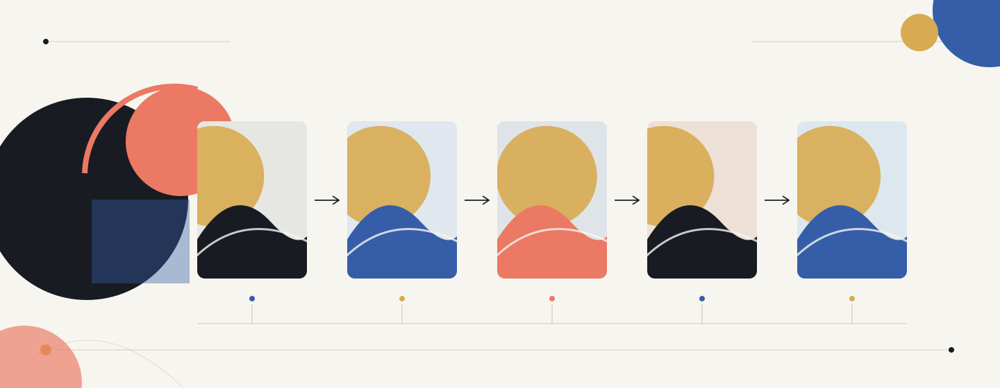

# Session 1: Image & Video Prompting and Workflow Design

[Back to the course homepage](./readme.md)

**Duration:** 2 h 20 min (140 minutes), including a 10-minute break.  
**Delivery:** Online or in person, to be confirmed. Activities and learning goals are the same in either format.  
**Class:** 30 students, working in six groups of five for Artistic Telephone.  
**Tools:** Replicate web UI, a prepared Jupyter Notebook, and SWITCHdrive.

Start with the [Replicate basics notebook](./notebooks/01_replicate_basics.ipynb), or its [structured scene-prompt version](./notebooks/01b_replicate_scene_prompts.ipynb), then use the [Artistic Telephone notebook](./notebooks/02_artistic_telephone.ipynb) for the game. Read the [Jupyter setup instructions](./notebooks/README.md) before class.

## Focus

- Prompt structure and techniques for image and video generation
- Storyboarding, scene descriptions, and visual consistency
- Designing and iterating multi-step image/video workflows

We will follow a concrete process:

**Concept → storyboard → scene prompts → generated images/video → refinement**

Artistic Telephone explores how meaning changes through reinterpretation. We then use that experience to decide which details to preserve deliberately.

## Learning goals

By the end of the session, you should be able to:

- Write scene prompts describing subject, style, lighting, composition, and camera position.
- Distinguish an image description from instructions for subject motion and camera movement.
- Observe and explain interpretation drift in a chain of generated images.
- Plan a short visual sequence and identify what should remain consistent.
- Document an iteration and explain why you changed the prompt.

## Session schedule

| Block | Activity | Duration |
| --- | --- | --- |
| 1 | How models work and visual workflow introduction | 10 min |
| 2 | Replicate web UI and visual prompt craft | 15 min |
| 3 | Notebook walkthrough and first generation | 20 min |
| | Break | 10 min |
| 4 | Artistic Telephone | 45 min |
| 5 | Chain reveal and discussion | 15 min |
| 6 | Storyboard, refinement, and video demonstration | 20 min |
| 7 | Save work and wrap up | 5 min |
| | **Total** | **140 min** |

## Block 1: Visual workflow introduction

### 1. How Text-to-Image / Video Models Work

How does a text description become an image or video? We will connect the concepts from your technical sessions to the visuals you generate. The slides will be available here as a PDF.

### 2. From concept to visual workflow

Consider this example: **a quiet city gradually waking up**.

A three-shot sequence might move from a wide view of a misty street, to a cyclist crossing a bridge, to a close-up of a bicycle wheel on the wet pavement. The concept, storyboard and scene prompts connect these shots into a visual sequence.

What connects the shots? What must stay the same, and what changes from one scene to the next?

We will look at how a description guides an output and where the result differs from what you intended.

## Block 2: Replicate web UI and visual prompt craft

### Build a scene prompt

Use this structure as a starting point, not a mandatory formula:

**Subject and action → setting → medium/style → lighting → composition/camera → mood**

Think like a director: **Who? What? Where? When? How?**

Compare a plain prompt:

> A cyclist crosses a bridge.

With a more specific scene:

> At dawn, a cyclist wearing a mustard-yellow raincoat crosses a foggy stone bridge. Warm orange light cuts through the mist. Wide shot from street level, muted blue-grey palette, cinematic photography.

Identify which details describe content, which describe visual treatment, and which may be ambiguous.

### Explore style and composition

In pairs, rewrite a plain scene in three styles: realistic, surreal, and graphic. Generate one selected version and discuss what changed.

Open the class model in Replicate's web UI. Notice the difference between a scene description and model settings, such as image dimensions. Use negative prompts or other controls only when the model supports them.

Compare the example outputs from different models. Which details of the same prompt are interpreted differently?

## Block 3: Notebook walkthrough and first generation

Continue the same task in Jupyter using the [short API notebook](./notebooks/01_replicate_basics.ipynb) or its [scene-prompt version](./notebooks/01b_replicate_scene_prompts.ipynb). Both follow the same API steps. The scene-prompt version turns the Block 2 structure into an editable dictionary, then assembles and displays a single text prompt. It starts with an offline practice diagram; switch to live mode when we begin generating images together:

1. Enter your API token privately using the supplied setup method.
2. Use the initial class model example and edit the prompt. The basics notebook uses one model; the Telephone notebook adds a curated dropdown.
3. Run the generation cell.
4. Display and save the image.
5. Record the prompt, model, relevant settings, and a short observation.

In the scene-prompt version, the `scene` dictionary holds subject, action, setting, time, medium/style, lighting, composition/camera, palette and mood. These are writing aids, not separate Replicate parameters. Only the assembled text is sent as `inputs["prompt"]`; image dimensions and output format remain model settings.

The notebook uses the same kinds of inputs as the web UI. You edit text and a few settings; you do not need to write Python from scratch.

Keep a baseline and one revised prompt in the record. Choose one intentional change, such as camera angle or lighting, and explain what you expected it to do. A single pair of outputs is an observation, not proof that a prompt change always works.

Use provided example images if generation is unavailable. Never include API tokens in saved notebooks or submissions.

## Block 4: Artistic Telephone

**Purpose:** practice scene and style prompting while experiencing how meaning shifts through reinterpretation.

### Group structure

Work in one of six groups of five. All passing stays within your group, following a fixed circular order:

**S01 → S02 → S03 → S04 → S05 → S01**

You will play five rounds. Start your own chain in round one. In later rounds, describe the image you receive from the previous person and generate a new interpretation.

### Each round

1. Inspect only the image assigned to you.
2. Write your own scene description without seeing the previous prompt.
3. Generate an attempt from that description. Revise and try again within the round's time and spending budget.
4. Save each attempt privately, compare the results, and select the one you want to pass.
5. Upload only the image to your group's SWITCHdrive folder for the next participant.

Use the same class image model during the game. Do not pass a Replicate generation-page link, because it may reveal the prompt. Keep prompt records private until the reveal.

Retain the familiar filename notation, such as `01.png`, `01_02.png`, and `01_02_03.png`. The Telephone notebook calculates file assignments and exports the selected PNG with that attempt's prompt and settings hidden in its pixels for the final reveal. Pass the original file without resizing or converting it. Upload it through SWITCHdrive. Shared folders rely on the rule to open only the assigned image.

Starter themes can include *Serenity*, *Ritual*, *Metropolis*, *Decay*, *Connection*, and *Chaos*. Ambiguity and unexpected interpretations are part of the game.

The 45-minute block includes image transfers. Leave time in each round to select and upload your image.

[Artistic Telephone guide](./activities/artistic_telephone.md): the five-round flow, original notation, starter themes, and handoff instructions for 30 students.

## Block 5: Chain reveal and discussion

We will view the image chains in order and reveal the prompts behind them. Choose one chain with your group and discuss how it changed.

- Which subjects, colours, or compositions persisted?
- Which details disappeared or changed?
- Where did wording suggest a change, and where might generation variability have contributed?
- When was drift interesting, and when did it conflict with the intended result?

Which chain would you nominate for Most Surprising Transformation or Best Scene Composition?

## Block 6: Storyboard, refinement, and video demonstration

Use the three-shot template below to plan a short sequence.

### Plan and refine (12 minutes)

Choose a group image and sketch a short sequence around it. Simple boxes and written descriptions are sufficient.

| Shot | Scene and composition | What stays consistent? | What changes? |
| --- | --- | --- | --- |
| 1 | Establish the location | Palette, style, subject descriptors | Wide framing |
| 2 | Show an action | Same selected descriptors | Action and viewpoint |
| 3 | Show a detail | Same selected descriptors | Close-up framing |

Identify one detail lost during the game, or one inconsistency to repair. Revise a scene prompt to address it. Generate one refinement if time permits and record the result; otherwise save the revised prompt and what you would check next.

### Image-to-video demonstration (8 minutes)

We will turn a selected image into a short video using [LTX 2.5 Fast in Replicate's web UI](./activities/image_to_video_webui.md). We can recreate a revealed group scene in 16:9 with FLUX.1 schnell before animating it. No extra notebook is needed, and generating your own video is optional.

Notice the difference between **subject movement** and **camera movement**:

> The cyclist moves slowly across the bridge while the camera tracks alongside. Mist drifts above the water; retain the dawn lighting and muted palette.

Follow how the starting image, motion description and model settings feed into the video request. Compare the result with the starting image: what moved, what changed in appearance, and what would you revise?

You can try generating a video as an optional extension. A completed video is not required.

## Block 7: Save work and wrap up

Keep the following together:

- Your image-chain contributions and associated prompts.
- Model/settings information and short observations.
- A three-shot storyboard with consistency notes.
- One revised prompt, why you changed it, and an output comparison if generated.

Preserve the first and revised outputs where available. Selected visuals can guide the audio work in Session 2 and support discussion in Session 3.
