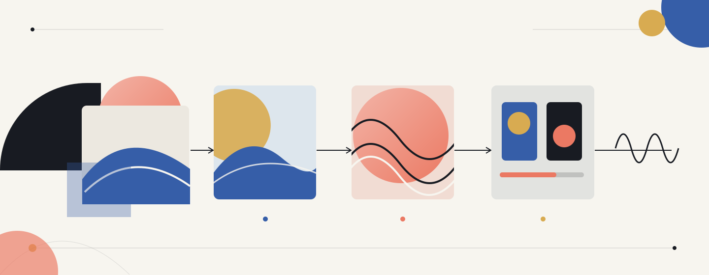

# 📘 Prompt Engineering (PROMPT H26)

Practical prompting for images, video, music, sound, and text, with an emphasis on creative experimentation, documented workflows, and critical reflection.

## Overview

These pages cover GM's three sessions. We move from visual generation to multimodal creation, then evaluate whether changes to prompts and workflows improve the results.

Each session lasts **2 h 20 min (140 minutes), including a 10-minute break**. All sessions can run **online or in person**, with the same activities and learning goals. The delivery format will be confirmed before each session.

## Sessions

| Session | Topic | Main activity | Materials |
| --- | --- | --- | --- |
| 1 | Image & Video Prompting and Workflow Design | Artistic Telephone, storyboard, and visual refinement | [Session materials](./day01.md) |
| 2 | Prompting for Audio, Music & Multimodal Workflows | PromptVision: an AI Eurovision-style creation sprint | H26 session materials coming next |
| 3 | Generative AI Evaluation Clinic | Human and automated evaluation of generated outputs | H26 session materials coming next |

### Session 1: Image & Video Prompting and Workflow Design

- Prompt structure and techniques for image and video generation
- Storyboarding, scene descriptions, and visual consistency
- Designing and iterating multi-step image/video workflows

Start with Replicate's web UI, then use a prepared Jupyter Notebook to record prompts, generate images, and compare iterations. Artistic Telephone makes interpretation drift visible; a storyboard and refinement task introduce deliberate consistency. We will also explore how to turn a still image into a short video. You can try this as an optional extension.

[Open Session 1](./day01.md), then start with the [Replicate basics notebook](./notebooks/01_replicate_basics.ipynb). For a structured version of the same API exercise, use [Replicate scene prompts](./notebooks/01b_replicate_scene_prompts.ipynb). The [Artistic Telephone notebook](./notebooks/02_artistic_telephone.ipynb) adds iteration, comparison and selected-image passing. At the end of the game, we will compare the image chains and reveal their prompts. See the [game guide](./activities/artistic_telephone.md) and [Jupyter setup instructions](./notebooks/README.md).

### Session 2: Prompting for Audio, Music & Multimodal Workflows

- Prompting for music and sound: genre, mood, tempo, voice, and other characteristics
- Combining text, image, audio, and video in multimodal workflows
- Choosing and iterating with the right media and tools for a project

In PromptVision, you will use a Session 1 visual to guide your audio, document iterations in a notebook, and share your work in a listening party with voting. Session materials will be available here.

### Session 3: Generative AI Evaluation Clinic

- Evaluation approaches across text, image, audio, and video generation
- Hands-on evaluation of text outputs, with image evaluation as a secondary focus
- Human feedback and simple automated evaluation to compare and improve prompts/workflows

We will compare Arena rankings with our own ratings, try a prepared Ragas text-evaluation exercise, and explore an ImageReward example. We will also discuss what can be evaluated in audio and video. Session materials will be available here.

## Competencies

**Professional**

- Design effective prompts for diverse AI tools and contexts.
- Adapt prompts to different models and use cases.
- Understand the limits and appropriate use of generative systems.
- Recognize privacy, security, and intellectual-property risks when using AI.

**Methodological**

- Test, compare, and refine prompts systematically.
- Document the inputs, outputs, and decisions in a creative workflow.
- Choose evaluation criteria appropriate to the medium and task.

**Personal**

- Engage critically and creatively with AI tools.
- Communicate transparently about AI-assisted work.
- Reflect on ethical and societal implications.

## Working tools

- **Replicate:** use the [web UI](https://replicate.com) and prepared API calls with your individual account.
- **Jupyter Notebook:** keep prompt versions, generated media, observations, and evaluation results together. Session 1 includes [the basics notebook, a scene-prompt version and Artistic Telephone](./notebooks/README.md); you edit prompts and run supplied cells. Later sessions' notebooks will follow.
- **Model selection:** use the model list provided for each activity.
- **SWITCHdrive:** share media within groups and submit work through the class folders. Folder links will be supplied in class.

Keep API tokens private and out of notebooks, screenshots, and submissions.

## Ethics & Reflection

Topics across the sessions include copyright and dataset provenance; bias and representation; disclosure of AI-assisted work; and authorship and responsibility when combining generated media.
